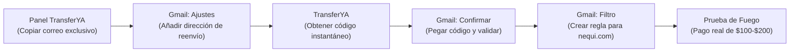

# Manual Operativo para Agentes Comerciales: Configuración de Reenvío Gmail (Canal B) en Clientes TransferYA

> [!NOTE]
> **Propósito del Documento:** Guiar al asesor o agente comercial en el acompañamiento técnico al comerciante para activar la **Ruta Gmail (Canal B)** de TransferYA. Este proceso toma entre 3 y 5 minutos y garantiza que el negocio valide pagos de Nequi y Bre-B aún si su celular está apagado, descargado, sin señal o fuera del local.

---

## 1. Fundamentos para el Asesor Comercial

### ¿Por qué es vital este canal para el cliente?
- **Redundancia Total (Zero-Downtime):** Si el celular del cajero se queda sin batería o no tiene datos, los pagos siguen validándose y los clientes reciben su confirmación en WhatsApp sin interrupciones.
- **Soporte Bre-B y Llaves:** Captura pagos interoperables enviados desde cualquier entidad financiera (DaviPlata, Bancolombia, Nu, etc.) que lleguen a Nequi.
- **Seguridad y Privacidad Garantizada (Ley 1581 Habeas Data):** Explicar al cliente con total tranquilidad que **solo se reenvían los comprobantes emitidos por Nequi**. Gmail jamás reenviará sus correos personales, estados de cuenta ni contraseñas.

---

## 2. Requisitos Previos antes de Iniciar

1. Que el comerciante tenga acceso a la cuenta de **Gmail** donde recibe las notificaciones de su cuenta Nequi.
2. Abrir la sesión en una computadora (o en el navegador del celular con la opción *"Sitio para computadoras / Modo escritorio"* activada en Chrome).
3. Tener abierto el panel administrativo del cliente en TransferYA (`https://www.transferya.app`).



---

## 3. Procedimiento Paso a Paso (Guía en 5 Etapas)

### Etapa 1: Obtener la Dirección Exclusiva de TransferYA
1. Ingresa al panel de TransferYA del cliente en [transferya.app](https://www.transferya.app).
2. En el menú lateral izquierdo, haz clic en **"Celulares de Caja"** (o pestaña **"Celulares, Cajas y Reenvío Gmail"**).
3. Ubica la tarjeta azul: **Canal B: Respaldo Gmail (Reenvío Automático)**.
4. En el campo **"TU DIRECCIÓN DE REENVÍO EXCLUSIVA"**, haz clic en el botón verde **`COPIAR`**.
   - *Ejemplo de formato:* `pago+5f38cd0c-7802-4cbf-98a3-e4fc71482dcb@transferya.app`

> [!IMPORTANT]
> Cada comercio tiene una dirección única generada a partir de su ID comercial. Nunca reutilices la dirección de un comercio en otro.

---

### Etapa 2: Registrar la Dirección en el Gmail del Cliente
1. En otra pestaña del navegador, abre el correo Gmail del comerciante ([mail.google.com](https://mail.google.com)).
2. Haz clic en el ícono de engranaje **⚙️ (Configuración)** en la esquina superior derecha y selecciona **"Ver todos los ajustes"**.
3. En la barra superior de ajustes, haz clic en la pestaña **"Reenvío y correo POP/IMAP"**.
4. En la sección superior, pulsa el botón **"Añadir una dirección de reenvío"**.
5. En la ventana emergente:
   - Pega la dirección copiada en la Etapa 1 (`pago+...@transferya.app`).
   - Haz clic en **"Siguiente"** y luego en **"Continuar"**.
   - Aparecerá un mensaje informando que se envió un código de confirmación. Haz clic en **"Aceptar"**.

---

### Etapa 3: Confirmación Instantánea (Handshake Zero-Touch)
1. Regresa inmediatamente a la pestaña de TransferYA.
2. En la misma tarjeta de Canal B, observa la sección derecha: **"CÓDIGO DE CONFIRMACIÓN DE GOOGLE"**.
3. En menos de 5 segundos, el sistema de TransferYA interceptará el correo de Google y mostrará en pantalla:
   - El código numérico de 9 dígitos en texto grande (ej. `948 201 583`).
   - Y/o un enlace directo: *"Confirmar en Google con un clic"*.
   *(Si tarda más de 5 segundos, presiona el botón "Sincronizar" en la esquina superior de la tarjeta).*
4. Copia el código numérico.
5. Regresa a Gmail, pega el código en el campo de verificación y haz clic en **"Verificar"**.
6. **¡Muy Importante!** Asegúrate de que en la sección de Reenvío de Gmail la opción seleccionada siga siendo:
   - 🔘 **Inhabilitar el reenvío** *(No queremos reenviar todo el correo del cliente, únicamente los pagos mediante el filtro del paso siguiente).*
7. Baja al final de la página y haz clic en **"Guardar cambios"**.

---

### Etapa 4: Crear el Filtro Inteligente de Pagos
1. En la configuración de Gmail, ve a la pestaña **"Filtros y direcciones bloqueadas"**.
2. Haz clic en la opción **"Crear un filtro"** (ubicada al centro de la pantalla).
3. En el formulario que se despliega:
   - En el campo **De (From)**, escribe exactamente:
     ```text
     (nequi.com OR bancolombia.com)
     ```
     *(Escribir `(nequi.com OR bancolombia.com)` garantiza que capture tanto los pagos de Nequi tradicionales, Nequi Bre-B, como los pagos por Código QR y transferencias de Bancolombia).*
   - Deja los demás campos en blanco.
4. Haz clic en el botón **"Crear filtro"** (en la esquina inferior derecha de la ventana modal, junto al botón azul de búsqueda).
5. En la siguiente lista de acciones, marca las siguientes casillas:
   - ☑️ **Reenviarlo a:** y selecciona en el menú desplegable la dirección `pago+...@transferya.app`.
   - ☑️ **No marcar nunca como Spam** *(Recomendado para evitar falsos bloqueos de Google).*
6. Haz clic en el botón azul **"Crear filtro"**.

> [!TIP]
> Si el comerciante ya tiene correos de pagos anteriores en su bandeja de entrada, **NO** es necesario marcar la casilla "Aplicar el filtro a las conversaciones que coincidan", ya que TransferYA solo necesita procesar los pagos nuevos en tiempo real.

---

### Etapa 5: Prueba de Validación en Vivo
Para cerrar el proceso y darle total tranquilidad al comerciante:
1. Pídele al comerciante o realiza tú mismo un pago de prueba de **$100 o $200 COP** a su Nequi o llave Bre-B.
2. Mantén abierto el panel de TransferYA en la pantalla principal de ventas (**"Resumen y Ventas"**).
3. **Verificación visual esperada:**
   - En 1 a 2 segundos sonará la alerta y se agregará la fila de la transacción.
   - En la columna **`CAJA / REF`**, debe aparecer la insignia estilizada:
     ```text
     ✉️ Gmail
     ```
   - El estado debe mostrar **`Válido • WA OK`** (o indicando que WhatsApp entregó la notificación).
   - En la pestaña de Cajas, la tarjeta **Respaldo Gmail** mostrará la etiqueta verde/cian **`GMAIL ACTIVO`**.

---

## 4. Guía Rápida de Solución de Problemas (Troubleshooting)

| Situación | Causa Probable | Solución para el Asesor |
| :--- | :--- | :--- |
| **No aparece el código de confirmación en TransferYA.** | Google aún no ha entregado el mensaje o se abrió otra cuenta. | Pulsa el botón **"Sincronizar"** en TransferYA. Si persiste, verifica que el correo copiado en Gmail sea idéntico al de TransferYA. |
| **Llega el pago a Gmail pero no aparece en TransferYA.** | El filtro se configuró con un remitente muy restringido (ej. solo `escribenos@nequi.com`). | Modifica el filtro en Gmail para que en el campo "De" tenga exactamente `nequi.com`. |
| **El cliente tiene miedo de que lean sus correos personales.** | Desconocimiento sobre cómo funcionan los filtros de Gmail. | Muéstrale que en Gmail la opción general está en *"Inhabilitar el reenvío"* y que el único filtro creado apunta exclusivamente a correos de `nequi.com`. |
| **El pago tardó varios segundos en reflejarse.** | Retraso en la red celular del cliente para enviar el correo. | Normal en horas pico bancarias de Nequi. La latencia típica promedio es de 600 ms a 1.2 segundos. |

---

## 5. Argumentario de Venta para el Asesor (Pitch de Valor)
> *"Don/Doña [Nombre del Cliente], con esta configuración su negocio queda blindado con **tecnología de redundancia bancaria**: si el cajero se lleva el celular a almorzar, si se descarga la batería o se cae el WiFi de la tienda, sus ventas siguen verificándose en milisegundos y sonando en su pantalla gracias a la conexión directa con Gmail. ¡Su dinero y sus ventas nunca se detienen!"*
