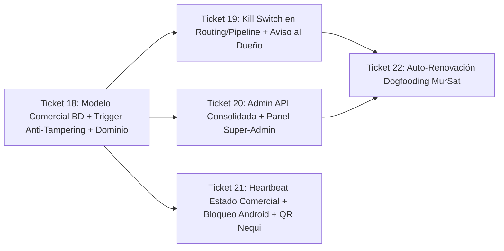

# Fase 3: Motor Comercial, Facturación y Panel Admin (Feature-First)

> **Nota de numeración:** Las fases previas en `.scratch/` cubrieron del Ticket 01 al Ticket 17 (`17-cicd-github-actions-vercel-release-apk.md`). Los tickets de **Fase 3 Comercial** continúan de forma correlativa del **Ticket 18** al **Ticket 22**.

---

## Mapa de Dependencias

---

## Ticket 18 — Modelo de Datos Comercial, Seguridad RLS de Facturación y Dominio Compartido

**Objetivo:** Extender Supabase (`merchants`) y el dominio TypeScript para gestionar el ciclo comercial (`TRIAL`, `ACTIVE`, `PAST_DUE`, `SUSPENDED`), el instante exacto de vencimiento (`subscription_ends_at`) y el teléfono del dueño (`billing_phone`), blindando esos campos contra manipulación desde el navegador.

- **Dependencias:** Ninguna (base para Tickets 19, 20 y 21).
- **Alcance técnico:**
  1. Migración `supabase/migrations/20261113000001_commercial_billing_schema.sql`:
     - ENUM `subscription_status_enum AS ENUM ('TRIAL', 'ACTIVE', 'PAST_DUE', 'SUSPENDED')`.
     - Columnas en `merchants`: `subscription_status` (default `'TRIAL'`), `subscription_ends_at` (default `NOW() + INTERVAL '7 days'`), `billing_phone VARCHAR(25)`.
     - Backfill idempotente desde `subscription_expires_at` y `status` existentes.
     - Trigger `BEFORE UPDATE` `prevent_merchant_billing_tampering()` que impide a sesiones `authenticated` modificar `subscription_status`, `subscription_ends_at` o `status` (solo permitido a `service_role` / SQL Editor), dejando editable `name` y `billing_phone`.
     - Índice `idx_merchants_subscription ON merchants (subscription_status, subscription_ends_at)`.
  2. Dominio compartido (`src/domain/routing/billing.ts`, `src/domain/routing/types.ts`, `src/domain/routing/service.ts`):
     - `SubscriptionStatus`, `evaluateEffectiveSubscriptionStatus(merchant, nowMs)`, `isSubscriptionAllowedToDispatch(status)`, `getRemainingSubscriptionDays(endsAtMs, nowMs)`.
  3. Adaptador `SupabaseRepository`: lectura transparente de columnas comerciales con compatibilidad retroactiva (`select=*`).
  4. UI Web (`public/index.html`): insignia de plan/días restantes y configuración de `billing_phone` del dueño en **Cajeros WhatsApp**.
- **Criterios de aceptación estrictos:**
  - Migración idempotente ejecutada sin errores ni cortes sobre `Mursat Solutions`.
  - Un `PATCH` desde usuario `authenticated` intentando cambiar `subscription_status` o `subscription_ends_at` falla en PostgreSQL (`42501`), mientras actualizar `billing_phone` funciona.
  - `evaluateEffectiveSubscriptionStatus` retorna `PAST_DUE` exactamente cuando `nowMs > subscriptionEndsAt`.
  - Pruebas unitarias de dominio y validación DDL/trigger en Vitest al 100%.

---

## Ticket 19 — Kill Switch en Routing/Pipeline y Alerta de Cobro al Dueño (`IGNORED_SUSPENDED_ACCOUNT`)

**Objetivo:** Mantener la ingesta `HTTP 202` en el Webhook para no colapsar Android, extraer monto y remitente mediante el parser y abortar el despacho a cajeros cuando la suscripción esté vencida o pausada, enviando alerta comercial al `billing_phone` del dueño.

- **Dependencias:** Ticket 18.
- **Alcance técnico:**
  1. Ampliar `RoutingFailureReason` con `'SUBSCRIPTION_PAST_DUE' | 'SUBSCRIPTION_SUSPENDED'` en `MerchantRoutingService.resolveRoute`.
  2. Actualizar `PaymentProcessingPipeline.processCapturedNotification`:
     - Si el enrutamiento falla por `SUBSCRIPTION_PAST_DUE` o `SUBSCRIPTION_SUSPENDED`:
       1. Marcar la notificación en Supabase como `status = 'IGNORED_SUSPENDED_ACCOUNT'` conservando `amount`, `sender_name` y `payment_reference`.
       2. Si `merchant.billingPhone` es válido (E.164), enviar recordatorio comercial vía `WhatsAppCloudApiClient` al WhatsApp del dueño con el monto detectado y valor de renovación, aplicando cooldown anti-spam (máx. 1 aviso cada 6h por comercio).
       3. Abortar el pipeline sin despachar mensajes a `cashier_recipients`.
  3. Mantener `POST /api/v1/webhooks/notifications` devolviendo `HTTP 202 Accepted`.
- **Criterios de aceptación estrictos:**
  - Comercio en `PAST_DUE` o `SUSPENDED` sigue recibiendo `HTTP 202` en el Webhook sin reintentos infinitos desde Android.
  - Cero mensajes enviados a ningún número de `cashier_recipients` cuando `now() > subscriptionEndsAt` o estado `PAST_DUE` / `SUSPENDED`.
  - `captured_notifications` registra `status = 'IGNORED_SUSPENDED_ACCOUNT'` con `amount` poblado y despacha alerta al dueño respetando cooldown.
  - Pruebas unitarias completas en `merchant-routing.test.ts`, `payment-pipeline.test.ts` y `whatsapp-cloud-api.test.ts`.

---

## Ticket 20 — Admin API Consolidada y Panel "Control de Usuarios & Suscripciones" (Completado)

**Objetivo:** Implementar endpoints administrativos protegidos por rol Super-Admin (Mursat Solutions) y consola web para ejecutar **Activar Trial**, **+30 Días Pro**, **Pausar** y **Reactivar**.

- **Estado:** ✅ Completado. 15 pruebas unitarias pasando (`subscriptions-admin.test.ts`), función serverless 8/12 en Vercel, panel integrado en `public/index.html` (restringido con `hidden` para no-admins) y vista dedicada en `public/admin.html`.
- **Dependencias:** Ticket 18.
- **Alcance técnico:**
  1. Endpoint consolidado `api/v1/admin/subscriptions.ts` (+ lógica pura en `src/backend/admin/subscriptions.ts`) respetando el límite de 12 Serverless Functions de Vercel Hobby (8/12):
     - Validación de JWT contra Supabase Auth + verificación contra `ADMIN_OWNER_IDS` / `ADMIN_EMAILS`.
     - `GET`: lista comercios con estado efectivo (`TRIAL`/`ACTIVE`/`PAST_DUE`/`SUSPENDED`), `subscription_ends_at`, `billing_phone`, total de cajas y último heartbeat.
     - `POST` (`{ merchantId, action }`):
       - `ACTIVATE_TRIAL`: `subscription_status = 'TRIAL'`, `status = 'ACTIVE'`, `subscription_ends_at = NOW() + 7 days`.
       - `EXTEND_30_DAYS`: `subscription_ends_at = GREATEST(NOW(), subscription_ends_at) + 30 days`, `subscription_status = 'ACTIVE'`, `status = 'ACTIVE'`.
       - `PAUSE`: `subscription_status = 'SUSPENDED'`.
       - `RESUME`: `ACTIVE` si `subscription_ends_at > NOW()`, o `PAST_DUE` si ya venció.
  2. Vista/panel **"Control de Usuarios & Suscripciones"** (`public/admin.html`) con filtros, contador de días restantes y botones de acción.
- **Criterios de aceptación estrictos:**
  - `401` sin JWT; `403` para usuarios autenticados que no pertenezcan a `ADMIN_OWNER_IDS` / `ADMIN_EMAILS`.
  - `+30 Días Pro` sobre cuenta vencida fija `NOW() + 30 días`; sobre cuenta vigente extiende +30 días preservando los días restantes.
  - Total de funciones Serverless en `api/` <= 12.
  - Pruebas unitarias en `src/backend/admin/__tests__/subscriptions-admin.test.ts`.

---

## Ticket 21 — Heartbeat con Estado Comercial y Pantalla de Bloqueo + QR Nequi en Android (Completado)

**Objetivo:** Devolver `subscription_status` desde `/api/v1/devices/heartbeat` hacia Android para detener la captura/envío bancario cuando la cuenta esté en `PAST_DUE` o `SUSPENDED`, mostrar pantalla roja de bloqueo comercial con QR de Nequi y auto-reactivar tras pago.

- **Estado:** ✅ Completado. Backend extiende heartbeat con `{ subscription_status, subscription_ends_at, remaining_days, billing_qr_payload, billing_amount_cop }`. Android Centinela `v0.3.0-beta` compilado con R8 y APK disponible en `public/downloads/`, aborta captura bancaria en `PAST_DUE`/`SUSPENDED`, muestra pantalla de cobro con QR Nequi renderizado con ZXing y botón "Ya pagué, verificar estado". Pruebas Vitest y JUnit pasando al 100%.
- **Dependencias:** Ticket 18 (y Ticket 20 para pruebas E2E con `+30 Días Pro`).
- **Alcance técnico:**
  1. Backend (`DeviceHeartbeatHandler` + `api/v1/devices/heartbeat.ts`): consultar comercio asociado e incluir `{ success: true, subscription_status, subscription_ends_at, billing_qr_payload, billing_amount_cop }` en la respuesta `HTTP 200`.
  2. Android (`v0.3.0-beta`):
     - `HeartbeatEmitter` y `SharedPreferencesCredentialsStorage` persisten `subscription_status`, `subscription_ends_at` y `billing_qr_payload`.
     - `SentinelForegroundService` cambia a intervalo liviano de 5 min en estado `PAST_DUE`/`SUSPENDED` para escuchar auto-reactivación sin drenar batería.
     - `SentinelNotificationListener.onNotificationPosted` aborta de inmediato antes de persistir en SQLite o llamar al webhook mientras el estado comercial sea `PAST_DUE` o `SUSPENDED`.
     - `MainActivity` muestra pantalla roja de bloqueo comercial con QR Nequi renderizado nativamente con `zxing`, monto de mensualidad y botón **"Ya pagué, verificar estado"** (`triggerImmediateHeartbeat`).
- **Criterios de aceptación estrictos:**
  - En `PAST_DUE`/`SUSPENDED`, una notificación bancaria entrante no genera registros en SQLite local ni llamadas `POST /api/v1/webhooks/notifications`.
  - `MainActivity` muestra pantalla roja con QR Nequi legible mientras está bloqueada.
  - Tras pulsar `+30 Días Pro`, el siguiente ping (o el botón manual) devuelve `ACTIVE` y reanuda la captura automáticamente.
  - Pruebas Vitest en `heartbeat-handler.test.ts` + pruebas JUnit en Android (`HeartbeatEmitterTest`, `HeartbeatCoordinatorTest` y bloqueo del listener).

---

## Ticket 22 — Automatización de Cobros por Dogfooding (MurSat Solutions Auto-Renovación)

**Objetivo:** Usar el propio Centinela de MurSat Solutions para detectar pagos de mensualidad entrantes a su Nequi, conciliarlos por código de referencia o `billing_phone` y extender automáticamente `+30 Días Pro`.

- **Dependencias:** Tickets 19 y 20.
- **Alcance técnico:**
  1. Tabla `billing_invoices` (`id`, `merchant_id`, `amount_cop`, `reference_code` único, `status`: `PENDING`/`PAID`, `notification_id`, `expires_at`).
  2. Servicio `BillingReconciliationService` ejecutado en `PaymentProcessingPipeline` exclusivamente cuando `device_id === process.env.BILLING_SENTINEL_DEVICE_ID`:
     - Concilia por `reference_code` en el texto o `billing_phone` normalizado + `amount >= PLAN_PRO_PRICE_COP`.
     - Ejecuta `EXTEND_30_DAYS` atómicamente, marca la factura `PAID` (protegido contra duplicados por `payment_fingerprints`) y envía WhatsApp de confirmación al dueño.
- **Criterios de aceptación estrictos:**
  - Ningún dispositivo de comercio cliente puede ejecutar auto-renovación; solo `BILLING_SENTINEL_DEVICE_ID`.
  - Misma huella SHA-256 nunca acredita doble renovación.
  - Montos inferiores al valor del plan no renuevan automáticamente y registran auditoría.
  - Pruebas unitarias en `src/backend/billing/__tests__/reconciliation.test.ts`.

